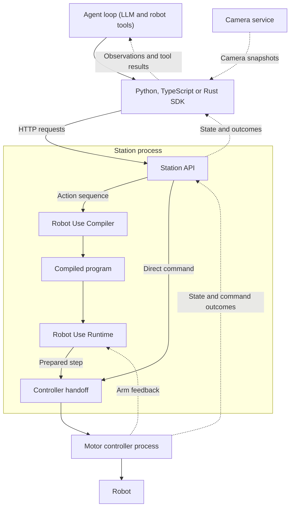

# Architecture

RUA helps you build robot-use agents. An LLM observes robot state and camera
images, chooses actions through robot tools, and uses the outcomes to decide
what to do next. Your application owns the model loop. RUA provides the SDKs,
compiler, runtime and motor control that execute its actions on the robot.

## Robot Use Compiler and Runtime

The station compiles action sequences automatically and prepares each step
against live robot state. Scripts and other SDK clients can use the same
commands and action sequences directly.

1. The **Robot Use Compiler** checks the sequence against the station’s
   configured arm capabilities and translates it into typed operations,
   preserving the ordered steps and their arm groups. This stage can run
   before the client acquires a lease and can reuse unchanged operations.
2. The **Robot Use Runtime** prepares each step from current arm feedback and
   submits the participating commands for admission together. Execution checks
   live authority and arm state, and records each step’s outcome.
3. The **motor controller** applies final protective checks and drives the arms
   through the coordinated control loop.

Clients can also compile explicitly, inspect the artifact, and run it later by
ID. The station retains recent artifacts and writes inspection files for explicit
compilations. Each execution has its own outcome and uses fresh feedback. See the
[compile-before-running workflow](control-model.md#compile-before-running).

## Station and companion processes

The station owns the HTTP API, control leases, compilation artifacts and
recording sessions. Its supervised controller owns the motor buses and
coordinated control loop. An independent guard watches the powered controller.
The media companion owns snapshots and live video publishing. See the
[station reference](reference.md) for operation and recovery.

The [reference agent](../examples/typescript/agent/README.md) and the
[optional viewer](install-from-source.md#optional-viewer) are station clients.
Several clients can observe at once. One lease holder can send motion commands.
Use a trusted network because reachable clients can issue a stop. See the
[control model](control-model.md) for lease and interlock behavior.

## Components

| Owner | Location | Responsibility |
| --- | --- | --- |
| Shared contracts | [Rust contracts](../contracts/src/lib.rs) and [OpenAPI](../schemas/openapi.json) | Typed requests, outcomes and generated SDK contracts |
| Robot Use Compiler | [`server-core/src/compiler.rs`](../server-core/src/compiler.rs) | Structural analysis and typed robot operations |
| Artifact store | [`server-core/src/station_api/programs.rs`](../server-core/src/station_api/programs.rs) | Saved compilations, validity, retention and inspection |
| Robot Use Runtime | [`server-core/src/station_api/runtime.rs`](../server-core/src/station_api/runtime.rs) | Live step preparation, coordinated admission and truthful outcomes |
| Station host | [Station composition](../station/src/serve.rs) | HTTP composition and process supervision |
| Motor controller | [Motor loop](../server-core/src/control_loop/mod.rs) | Feedback, setpoints, protective checks and plant commands |
| Profile resolution | [Profile loader](../server-core/src/profile/mod.rs) | Models, per-arm hardware mapping and configured limits |
| Robot geometry | [Geometry library](../robot-geometry/README.md) | Robot models, kinematics and collision queries used by the planner |
| Camera access | [Station access](../station-access/README.md) | Camera credentials, token grants and invites |
| Camera companion | [Media CLI](../livekit-cameras/src/main.rs) | Capture, snapshots, publishing and recording video |
| Recording library | [Recording library](../recordings/src/library.rs) | Retained recordings and playback access |

The controller commands hardware and simulators through the same
[plant interface](../server-core/src/plant.rs). The
[controller guide](controller.md) explains which component owns each motion
path. The [simulator contract](simulators.md) describes how to attach an engine.

## Client SDKs

The [Python SDK](../hebbian_rua/client/README.md), [Rust SDK](../sdk/README.md)
and [TypeScript SDK](../typescript-client/README.md) use generated routes from
the shared Rust definitions and OpenAPI.
Provider adapters handle model-specific messages. See the
[Python adapters](../hebbian_rua/client/llm/) and
[TypeScript agent](../examples/typescript/agent/README.md). Rust applications
assemble provider messages from SDK tool results.

The [command-line client](../cli/README.md) uses the Rust SDK. Keep server code
independent of SDKs and provider adapters. Use the
[source setup](install-from-source.md) and [contributing guide](../CONTRIBUTING.md)
for validation commands.
