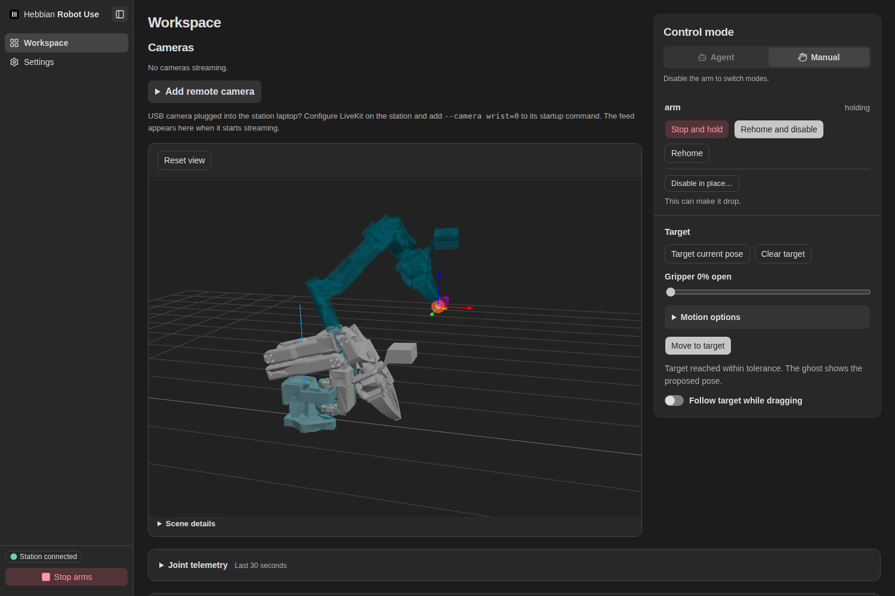

# Example viewer

The example Node server hosts the React viewer and agent loop. Run `pnpm build` and
`pnpm start:viewer`, then open <http://127.0.0.1:8793/viewer/>. Set
`HEBBIAN_STATION_URL` to connect to a station other than the local default. Follow the
[viewer build instructions](../../../docs/install-from-source.md#optional-viewer)
and start a station with [a real arm connected](../../../docs/getting-started.md)
whenever available. Reserve [MuJoCo simulation](../../../docs/simulation.md) for
testing without hardware.
The viewer uses the published TypeScript SDK pinned in the repository lockfile.
Use a station that implements the same schema.
Each browser tab opens a session on the viewer backend. The backend connects
to the station through the TypeScript SDK, streams state to the tab, and
releases its manual lease when the session ends. The browser renders the robot
model, connects directly to LiveKit for live video, and decodes recordings
served through the example backend. The station owns capture and storage.

## Use the viewer

In a narrow side pane, use the links at the top to switch between
**Workspace**, **Recordings**, and **Settings**. The **Workspace** shortcuts
jump to **Cameras**, **Control**, **Joint telemetry**, or **Run activity**.
**Stop arms** stays visible as you scroll.

The viewer offers **Manual** and **Agent** with a normal startup. See
[arm controls](../../../docs/so101-manual-control.md#controls) for manual
operation and [the agent example](../agent/README.md) for model setup. Open
**Camera setup** in **Workspace** to connect a local or remote camera. See
[the camera guide](../../../docs/cameras.md) for connection details and
[the recording guide](../../../docs/recording.md) for capture and playback.

[Options when LiveKit Cloud is unavailable](../../../docs/cameras.md#when-livekit-cloud-is-unavailable)

## Model API keys

Choose a provider in Agent Run. Follow **Set key** to save its API key in
this browser profile. Settings also lets you replace or remove a browser key.
The Node backend receives the selected key for that run. For shared devices,
anyone using the same browser profile can use its saved keys.

To supply a key for all users of the viewer, set `OPENAI_API_KEY`,
`ANTHROPIC_API_KEY`, or `GEMINI_API_KEY` in the viewer environment or
repository’s `.env`. Settings shows **Set in viewer environment** for these
providers. Change the value there and restart the viewer. Manual controls
and camera previews work without a model key.

## Develop the viewer

From the repository root, run `pnpm dev` and open the Vite viewer URL. Start the
station separately.
Use `pnpm check` and `pnpm test:viewer` to check changes.

- [`src/app/`](src/app/) contains the page entry points and workspace. The full
  viewer entry point adds recording controls and auto-record callbacks to the
  live workspace. Playback has its own entry point.
- [`src/features/`](src/features/) contains the controls, cameras, scene,
  recordings, and settings.
- [`server/src/`](server/src/) hosts the [reference agent](../agent/README.md).
- The [TypeScript SDK](../../../typescript-client/README.md) owns station access
  and shared schemas. See the [station reference](../../../docs/reference.md#station-server)
  to build a different viewer.
